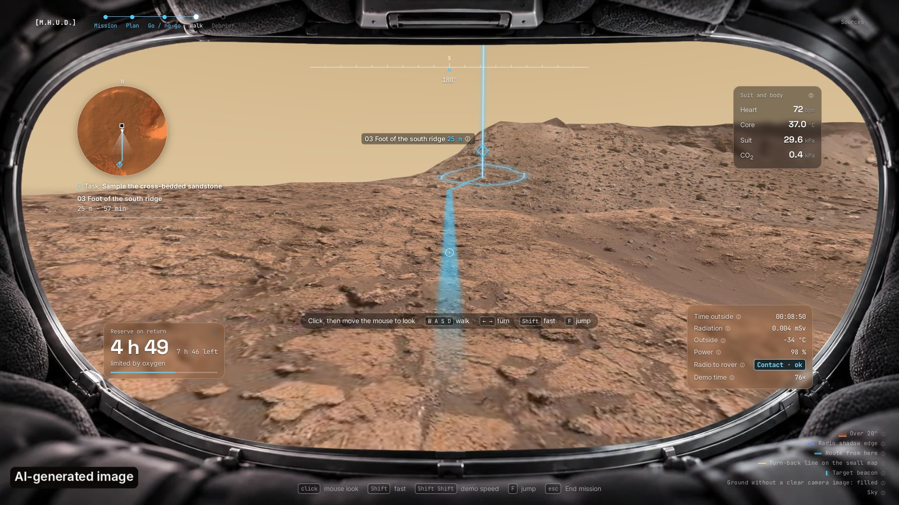
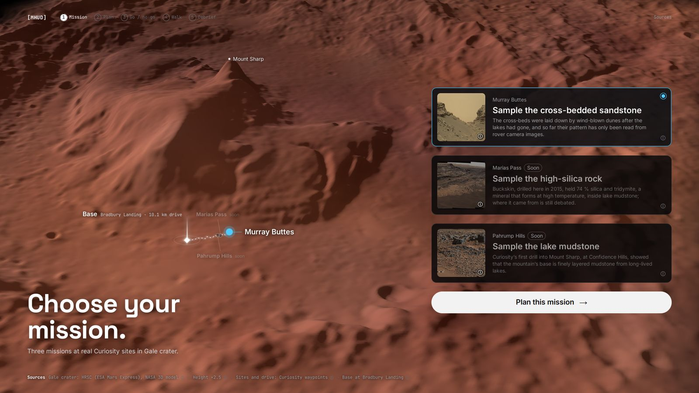
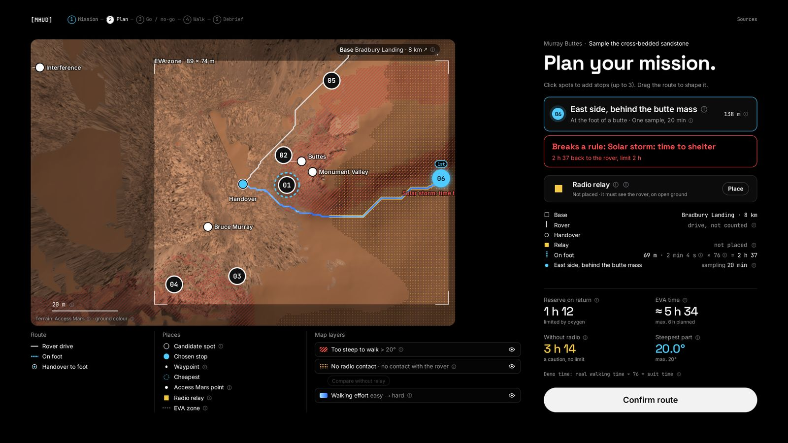
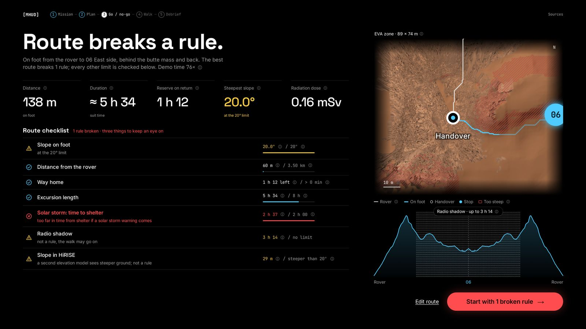
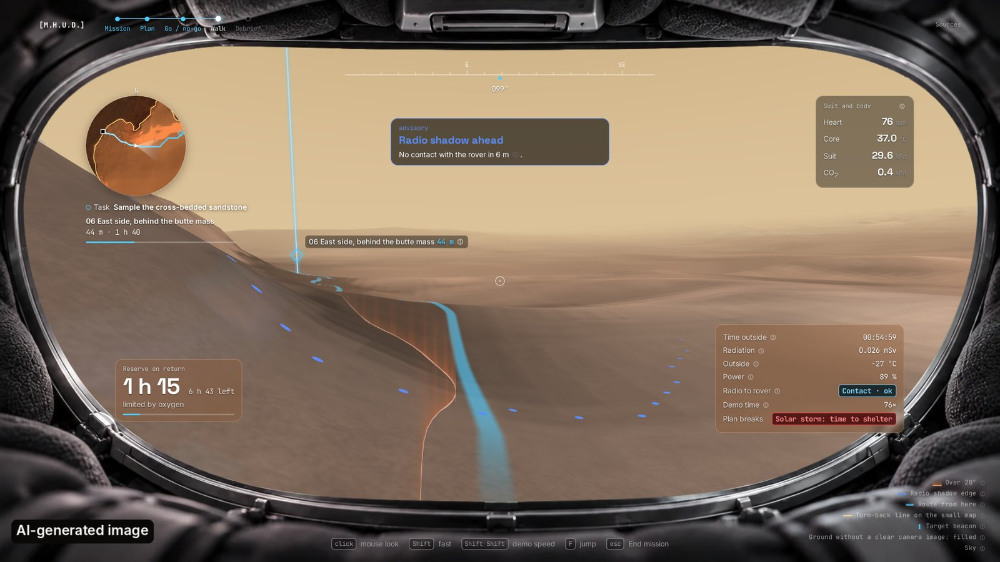
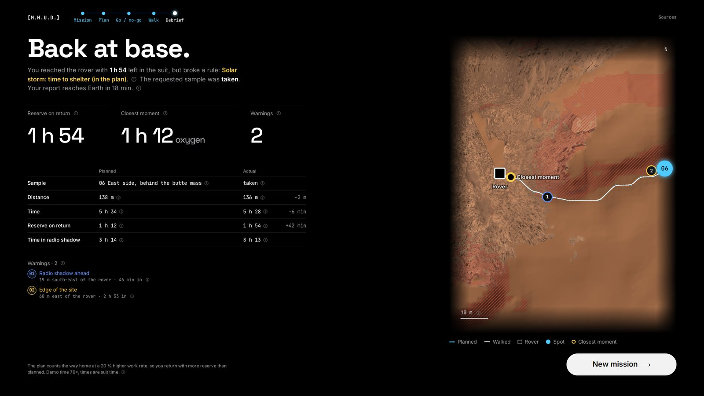
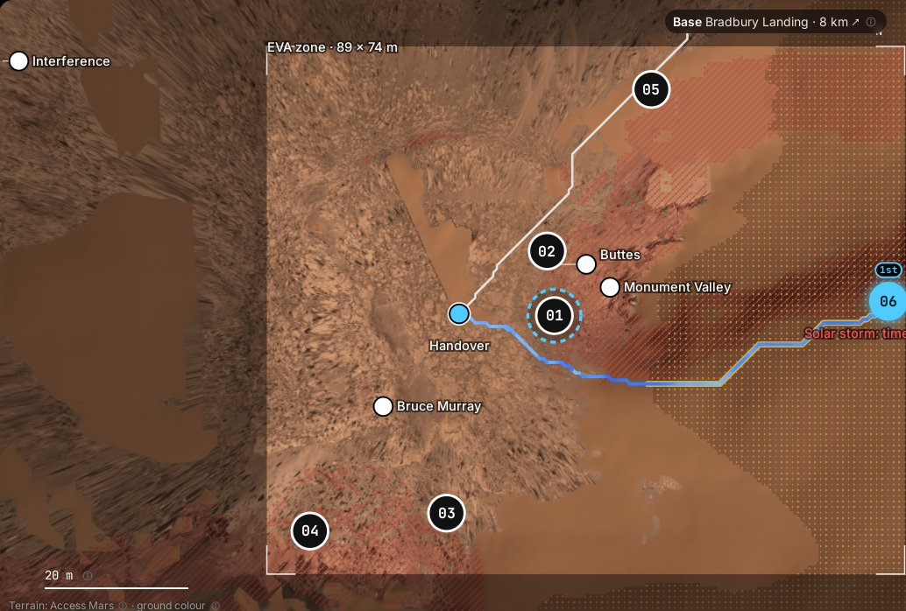
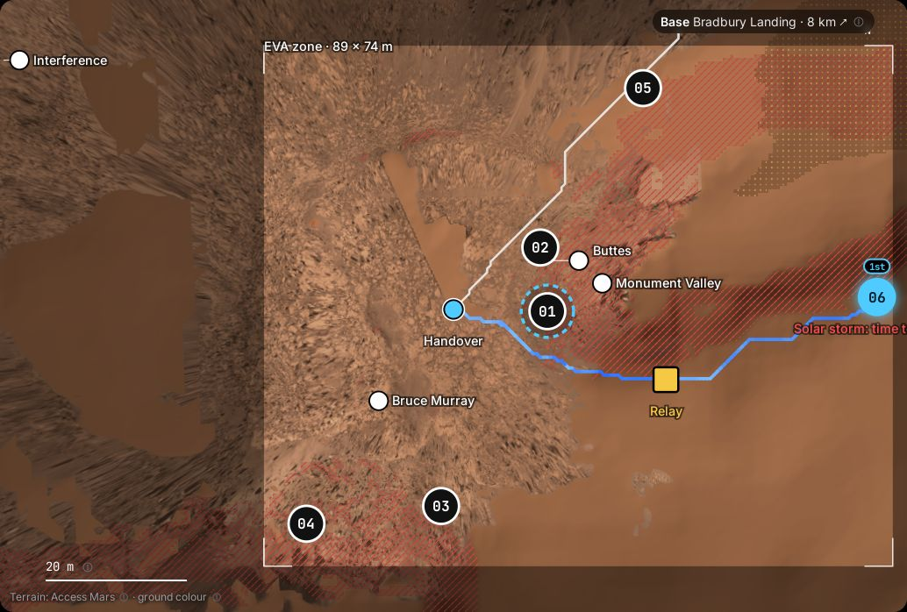

# M.H.U.D. – Martian Head-Up Display

A map for one excursion on foot on Mars that answers one question at every step: **from where I stand, can I still get home?**

**Live demo: https://lkubler.github.io/NASA-SpaceApp-26/**

Built at the NASA Space Apps Challenge 2026, local event Heilbronn, for the challenge
[Interplanetary Survival Guide: Martian Map](https://www.spaceappschallenge.org/2026/challenges/interplanetary-survival-guide-martian-map/).

<a href="docs/images/hero.jpg"></a>

<sub>The walk at Murray Buttes, Gale crater. The ground is a 3D reconstruction from Curiosity rover images. Helmet frame: AI-generated image.</sub>

## The journey in five pictures

The four pictures from Plan to Debrief show the same excursion: the farthest sample spot, with no radio relay placed.

| | |
|---|---|
| <a href="docs/images/mission.jpg"></a> | **1 Mission.** Gale crater with Curiosity's real drive line. The visitor picks one sample request. |
| <a href="docs/images/plan.jpg"></a> | **2 Plan.** The site from above. Red hatching: too steep to walk. Dots: radio shadow (ground from which the terrain blocks the line to the rover). The planner proposes the route out and back. |
| <a href="docs/images/go.jpg"></a> | **3 Go / no-go.** Seven checks, each with planned value, limit and status. Here one rule is broken (2 h 37 back to shelter if a solar storm warning comes, limit 2 h) and three cautions are open. |
| <a href="docs/images/walk.jpg"></a> | **4 Walk.** First person on the terrain. Always on: target, reserve on return, radio status, small map with the turn-back line. Warnings appear only when needed, here "Radio shadow ahead". Orange marks ground over 20°. <sub>Helmet frame: AI-generated image.</sub> |
| <a href="docs/images/debrief.jpg"></a> | **5 Debrief.** Planned against walked: distance, time, reserve on return, time in radio shadow, warnings. The crew returns with more reserve than planned because the plan counts the way home at a higher work rate. |

## How it works

Everything runs in the browser; no route is precomputed.

**Terrain.** The site is a 128 × 128 m square. Its 3D mesh comes from [Access Mars](https://github.com/googlecreativelab/access-mars) (Google Creative Lab with NASA/JPL-Caltech, built from Curiosity camera images). Offline, we turn the mesh into a grid of 256 × 256 cells of 0.5 m, each with a height and a slope.

**Route.** Dijkstra's shortest-path search over the grid, 8 neighbours per cell. A step costs its 3D length. Cells steeper than 20° are closed. A metre in radio shadow counts as 1.5 m, so the route prefers ground with contact; the distance and time shown stay the real ones. If no route keeps the slope rule, the planner shows the best one and marks the rule as broken.

**Suit.** Each step's slope sets a work rate (how hard the astronaut works, in watts):

```
work rate = 1200 BTU/h (about 350 W, Apollo walking value)
          + (3.71 / 9.81) × [ Pandolf(slope) − Pandolf(flat) ]     82 kg body, 23 kg load, 2 km/h
```

Pandolf is a load-carriage equation measured on Earth; the factor scales it to Mars gravity. Downhill counts as flat. Oxygen, CO2 removal and cooling water drain with the energy spent, the battery with time. Whichever runs out first sets the time left.

**"Can I get home?"** The reserve on return is the suit time left after the rest of the plan, with the way home counted at a 1.2× work rate (an Apollo planning margin). The turn-back point is the first place where turning back leaves zero reserve. In the walk the same calculation runs from where the crew stands: the small map draws the turn-back line (the edge of the ground from which the crew still gets home with reserve), and off the planned path the route is planned again from the current position.

**Radio.** Contact means a free straight line over the terrain from the rover antenna (2 m) to the suit antenna (1.83 m). The visitor can place one relay (3 m mast); a cell then also has contact if it sees the relay and the relay sees the rover.

<p>
<a href="docs/images/relay-off.jpg"></a>
<a href="docs/images/relay-on.jpg"></a>
</p>

<sub>Same route without and with the relay (yellow square): time without radio drops from 3 h 14 to 0 min.</sub>

## Design principles

- **Rules first.** Every limit comes from a published document: slope, excursion length, way-home margin, time to shelter in a solar storm. The planner, the checklist and the helmet read the same rules.
- **Every value is labelled.** Each number on screen carries *real* (measured or published), *model* (our calculation), *simulated* (placeholder) or *assumption*, with its source.
- **Two terrain models check each other.** The route is planned on the Curiosity reconstruction and then sampled every 0.5 m in the independent HiRISE elevation model (1 m, from orbit). Where HiRISE sees ground over 20°, Go / no-go shows a caution.
- **One set of numbers.** Plan, Go / no-go, Walk and Debrief use the same calculation, so a risk the plan marks warns at the same place in the walk.

## Data

| Dataset | Provider | What it does in the app |
|---|---|---|
| Access Mars 3D terrain, Murray Buttes | Google Creative Lab with NASA/JPL-Caltech; from Curiosity Mastcam/Navcam images | The ground: every slope, route, rule check and warning |
| HiRISE elevation model, 1 m | NASA/JPL/University of Arizona/USGS | Second opinion on the route's slope; position of the site |
| Curiosity waypoints | NASA/JPL-Caltech | Drive line and sites in the crater view |
| Gale crater 3D model (HRSC, Mars Express) | NASA 3D Resources; ESA/DLR/FU Berlin | Crater view, fitted to NASA MOLA altimetry |
| Curiosity RAD dose rate, 0.67 mSv/day | Hassler et al. 2014, SwRI/NASA | Radiation dose in Go / no-go and helmet (shown, not a rule) |
| Curiosity REMS air temperature, sol 1440 | REMS team (INTA-CSIC)/NASA | Outside temperature in the helmet |
| Curiosity photos, Mars globe, star map, rover model | NASA/JPL-Caltech/MSSS, NASA/GSFC, NASA/LaRC | Pictures and 3D models, visual only |

Twelve datasets reach the app; two carry decisions (Access Mars and HiRISE). The full inventory with every value, label and source is in [`docs/data-use.md`](docs/data-use.md), and on the Sources page of the app.

## Limits

- **Demo time.** The site is 128 m wide, so suit time runs 76× faster than walking time (an assumption, shown on screen). Distances are real. The reserve and the storm rule bind only because of this factor; the 2 km / 3.5 km distance limits never do.
- **Slopes come from the Curiosity reconstruction**, which is smoother than HiRISE (ground over 20°: 18.1 % against 18.7 %). HiRISE only cross-checks; it does not close ground or change the route. The two models are aligned to about 2 m.
- **Most rule limits are planning values for the Moon (Artemis) or from Apollo.** NASA has not set them for Mars. The app flags them.
- **Radio is geometric line of sight only**, no radio physics. The relay is simulated hardware. Heart rate, core temperature and suit pressure are simulated.

## Run it

```
git clone https://github.com/lkubler/NASA-SpaceApp-26.git
cd NASA-SpaceApp-26/app
npm ci
npm run dev      # http://localhost:5173
npm test         # unit tests
```

Static web app (Vite, Three.js), hosted on GitHub Pages. Data preparation: Python and Node scripts in [`scripts/preprocess/`](scripts/preprocess/README.md).

## Team and AI use

[HelloX3030](https://github.com/HelloX3030), [lkubler](https://github.com/lkubler), [t-ecker](https://github.com/t-ecker) – NASA Space Apps Challenge 2026, Heilbronn.

The idea and the requirements are the team's (see [`PROPOSAL.md`](PROPOSAL.md)). The code was written with Claude Code (Anthropic) from them. The helmet frame is an AI-generated image (ChatGPT) and is marked in the app. Full log: [`docs/ai-use.md`](docs/ai-use.md).

More: [pitch deck (PDF)](demo/presentation/MHUD-pitch.pdf) · [image credits for the deck](CREDITS.md) · [research notes with sources](research/)
